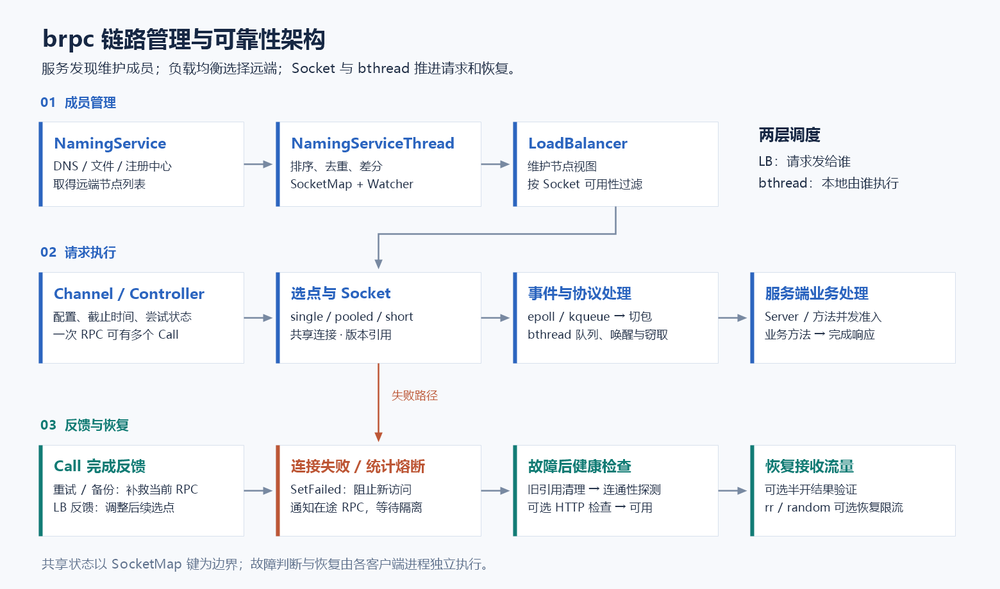
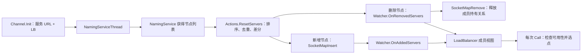
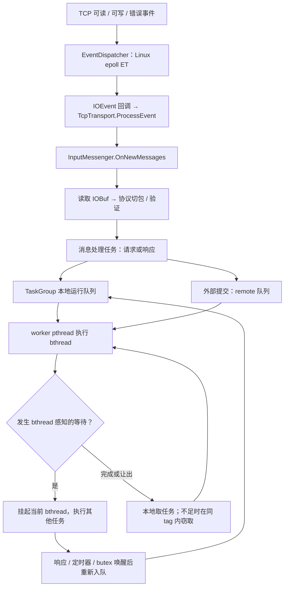
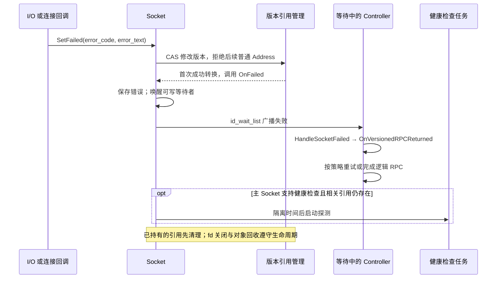
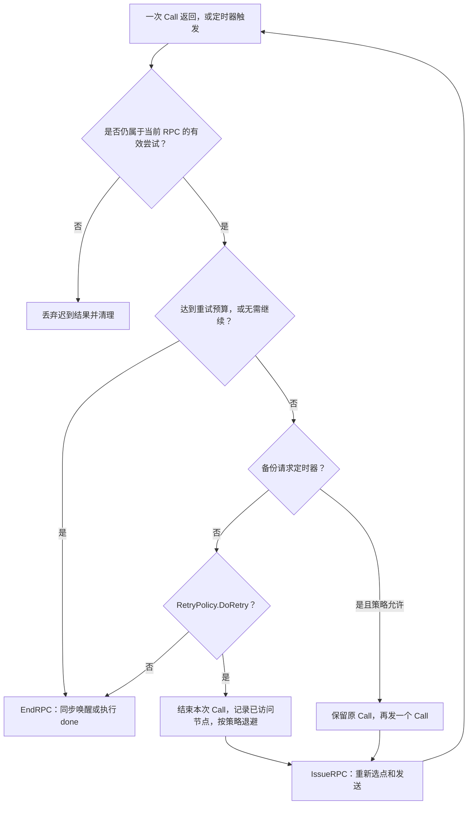
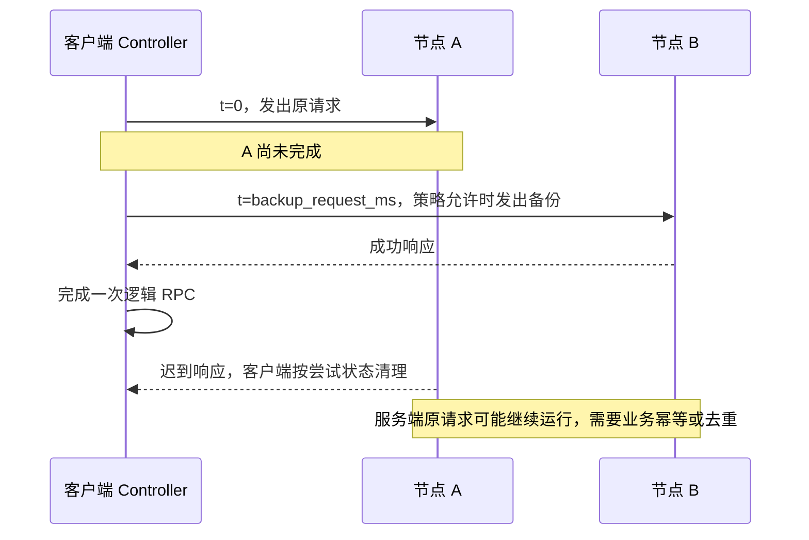
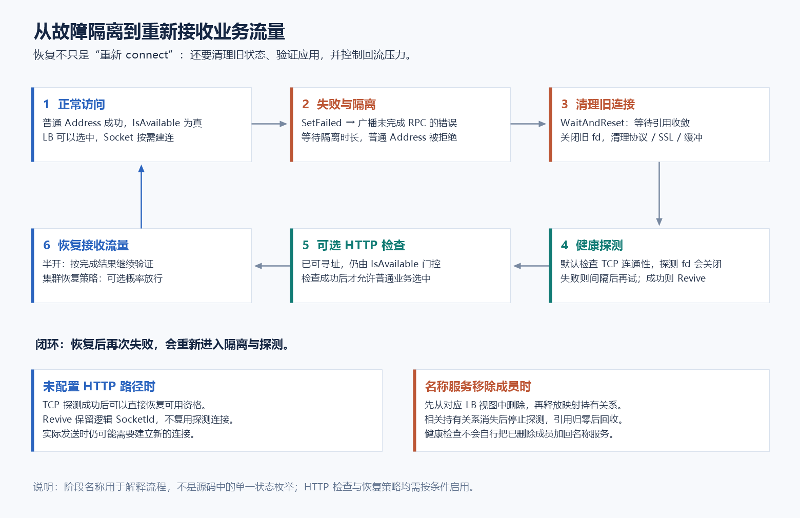
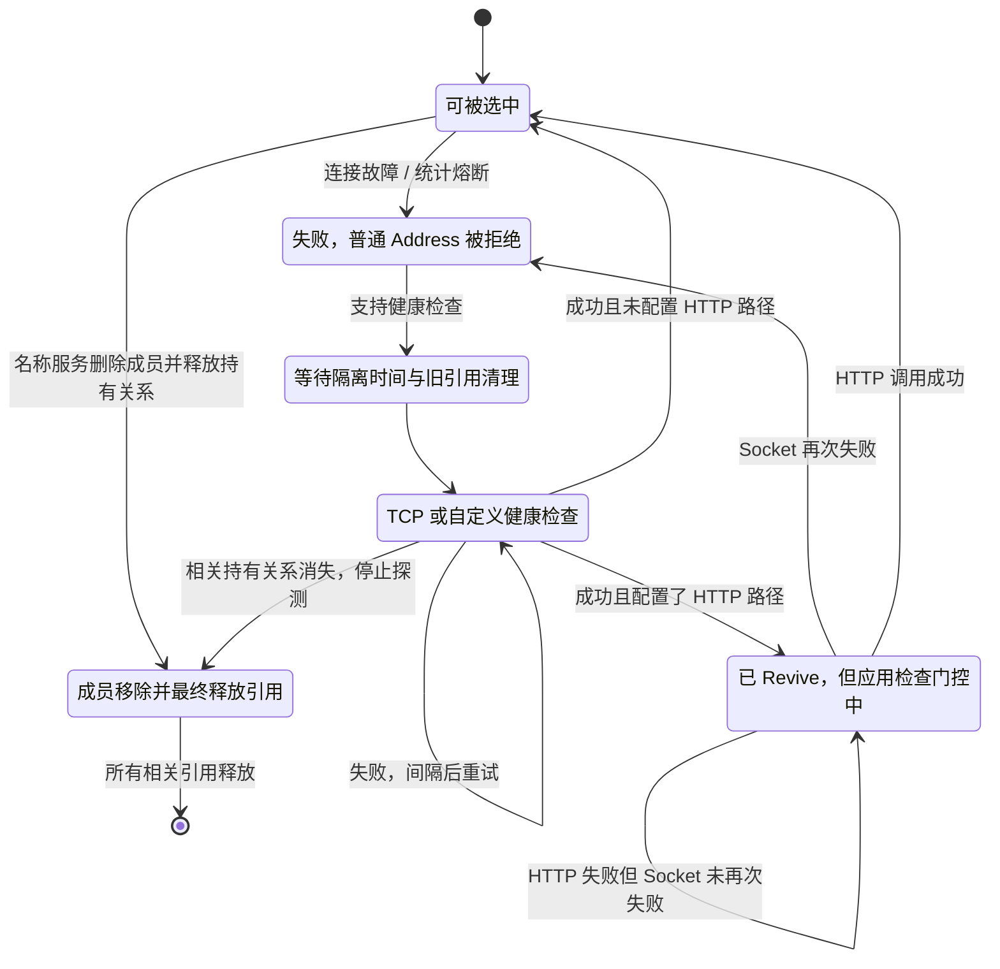

<!--
SPDX-License-Identifier: Apache-2.0

Licensed under the Apache License, Version 2.0 (the "License");
you may not use this file except in compliance with the License.
You may obtain a copy of the License at

    https://www.apache.org/licenses/LICENSE-2.0

Unless required by applicable law or agreed to in writing, software
distributed under the License is distributed on an "AS IS" BASIS,
WITHOUT WARRANTIES OR CONDITIONS OF ANY KIND, either express or implied.
See the License for the specific language governing permissions and
limitations under the License.
-->

# brpc 链路管理、调度、故障识别与恢复机制

> 分析基线：本仓库提交 `36c2d12e0f56b2a306f66e189d6f399b875d9c95`，整理于 2026-10-17。
> 本文以当前源码为准，重点分析客户端普通 RPC、TCP 传输和服务端请求处理；RDMA、URMA、共享内存传输与 Streaming RPC 的专有细节不在展开范围内。文中的默认值均指该提交的源码默认值，运行参数可以覆盖它们。

brpc 的可靠性来自多个层次的协同：命名服务维护节点成员，负载均衡选择目标，Socket 管理实际连接，bthread 执行异步任务；发生故障后，当前 RPC 通过重试或备份请求争取成功，故障节点则通过隔离、健康检查与恢复策略重新接收流量。

“链路”在这里指进程内管理的远端节点及其连接，不等同于分布式追踪中的 Trace。RPC 失败、连接失效、节点从命名服务下线，是三个不同事件。

## 阅读导航

- [1. 整体架构与对象边界](#1-整体架构与对象边界)
- [2. 链路管理：发现、共享、连接与回收](#2-链路管理发现共享连接与回收)
- [3. 调度：节点选择与本地任务执行](#3-调度节点选择与本地任务执行)
- [4. 故障识别：从传输错误到统计熔断](#4-故障识别从传输错误到统计熔断)
- [5. 当前 RPC 的补救：重试与备份请求](#5-当前-rpc-的补救重试与备份请求)
- [6. 节点恢复：隔离、探测、复活与流量保护](#6-节点恢复隔离探测复活与流量保护)
- [7. 服务端过载保护与优雅下线](#7-服务端过载保护与优雅下线)
- [8. 典型故障推演](#8-典型故障推演)
- [9. 配置示例与观测入口](#9-配置示例与观测入口)
- [10. 源码与测试索引](#10-源码与测试索引)

## 1. 整体架构与对象边界



图 1：服务发现、请求执行与故障恢复三个平面。下方反馈同时影响后续选点和连接可用性。

| 对象 | 管理什么 | 关键边界 |
| --- | --- | --- |
| `Channel` | 协议、超时、连接方式、服务地址和 LB | 通常复用；一个 Channel 可以访问多个节点，多个 Channel 也可以共享连接 |
| `Controller` | 一次逻辑 RPC 的截止时间、错误、重试、备份请求与完成回调 | 一次逻辑 RPC 可以包含多个实际 `Call`；每个并发 RPC 使用独立 Controller |
| `NamingServiceThread` | 名称解析过程、节点快照、Watcher 通知 | 可在匹配的服务与配置条件下共享，不是每次请求都重新发现节点 |
| `LoadBalancer` | 成员视图、选点与可选的结果反馈 | 决定“发给谁”，不负责执行本地业务线程 |
| 主 Socket | 节点入口、健康检查、连接池共享状态 | 是远端节点在客户端的管理锚点；不一定已经持有连接 fd |
| pooled / short Socket | 一次请求实际借用或创建的连接 | 与主 Socket 区分；可通过共享状态将严重故障反馈到节点层 |
| `TaskControl` / `TaskGroup` | worker pthread、bthread 运行队列、工作窃取 | 决定“由哪个本地 worker 执行”，与远端 LB 是两层调度 |

关键实现：[channel.h](../../src/brpc/channel.h)、[controller.cpp](../../src/brpc/controller.cpp)、[socket.h](../../src/brpc/socket.h)、[task_control.cpp](../../src/bthread/task_control.cpp)。

## 2. 链路管理：发现、共享、连接与回收

### 2.1 从服务名到可选节点

客户端既可用单个地址初始化 Channel，也可传入命名服务 URL 和 LB 名称。后者通过 `LoadBalancerWithNaming` 将名称服务与负载均衡连接起来。



`NamingServiceActions` 是控制反转接口：发现实现取得节点后通知框架。`PeriodicNamingService` 为轮询式实现提供公共骨架；`list://` 是静态地址列表，`file://` 可随文件变更更新，其他实现可接入 DNS、Consul、Nacos 等。具体注册表见 [global.cpp](../../src/brpc/global.cpp)。

当前 `ResetServers` 对新旧列表做集合差分，新增节点先获得 SocketId，再通知 Watcher；删除节点先通知 LB 移除，再释放 SocketMap 中对应持有关系。节点标签也是 `ServerNode` 身份的一部分，`ns_filter` 可过滤节点。

**成员变化与故障隔离是两条路径。** 命名服务删除会改变 LB 的成员视图；连接故障通常保留原来的成员和 SocketId，通过 `Socket::Address`、`IsAvailable` 使其暂时选不中。健康恢复后，不必再等一次名称服务新增通知。

### 2.2 连接共享：Channel 不独占 TCP 连接

`SocketMapKey` 包含 `ServerNode`（地址、tag）和 `ChannelSignature`。因此“地址相同就必然共享连接”并不准确。签名会考虑连接组、认证对象、SSL、客户端绑定、应用健康路径等相关配置，详细规则以 `ComputeChannelSignature` 为准。

`ChannelOptions.connection_group` 是主动划分连接共享范围的入口。例如把交互流量和批处理流量放入不同连接组，可让它们使用不同的连接及相应故障状态，但并不意味着获得了独立机器或独立 worker 资源。

共享的直接后果是：开启统计熔断的 Channel 可以使共用主 Socket 暂时不可用，其他共享它的 Channel 也会受影响；只有开启 `enable_circuit_breaker` 的 Call 才向该统计熔断器提交结果。

源码：[socket_map.h](../../src/brpc/socket_map.h)、[channel.cpp](../../src/brpc/channel.cpp) 的 `ComputeChannelSignature`。

### 2.3 三种连接方式

| 模式 | 获取和释放 | 并发与使用边界 |
| --- | --- | --- |
| `single` | 通常直接在选中的主 Socket 上发送；按需建立实际连接 | 可支持多个在途请求，取决于协议关联响应的能力；“single”是每个共享键的单连接模式 |
| `pooled` | 从节点连接池借出，池为空则新建；满足复用条件后归还 | 普通借用路径中，同一个池连接不会同时借给多个 RPC；适用于需要连接级请求隔离的协议 |
| `short` | 按调用创建实际 Socket，完成后关闭 | 避免长期复用，但增加建连和握手成本 |

不显式设置 `connection_type` 时，采用协议的默认连接方式。`Init` 成功也不代表所有节点已经完成 TCP 建连；主 Socket 可以先作为逻辑节点存在，首次发送时才连接。

`pooled` 模式有一个重要保护：**调用失败且尚未收到响应时，不将连接直接归还池中**。否则迟到响应可能被下一次借用误认。当前代码还支持事务所需的连接保留、绑定，以及渐进读取的延迟归还；它们是普通归还路径的例外。

`max_connection_pool_size=100` 控制空闲连接保留量，池中无可用连接仍可新建，不能把它理解为“该节点最多允许 100 个并发请求”。`idle_timeout_second=30` 用于清理空闲池连接；`defer_close_second=0` 默认不延迟释放已无使用者的映射连接。

源码：[controller.cpp](../../src/brpc/controller.cpp) 的 `IssueRPC`、`Call::OnComplete`；[socket.cpp](../../src/brpc/socket.cpp) 的 `SocketPool::GetSocket`、`ReturnSocket`；[socket_map.cpp](../../src/brpc/socket_map.cpp)。

### 2.4 身份与生命周期：SocketId + 版本引用

框架鼓励保存 SocketId，访问时用 `Socket::Address` 取得 `SocketUniquePtr`。Socket 继承 `VersionedRefWithId`：身份包含槽位和版本，引用计数保护仍在使用的对象，版本变化防止资源池复用后旧 ID 错指向新对象。

`SetFailed` 通过 CAS 将内部版本由 `id_ver` 改为 `id_ver+1`，让后续普通 `Address` 失败，并且只有成功改变状态的一方执行 `OnFailed`。已持有引用的路径可完成清理。引用归零后才能回收；需要健康检查的主 Socket 则由相关持有关系维持生命期，以便原地恢复。

这里应区分：**故障会先撤销新访问资格，底层 fd 的关闭和对象回收可以随后发生。** `SetFailed` 不能简单等同于立即销毁 Socket。

源码：[socket_id.h](../../src/brpc/socket_id.h)、[versioned_ref_with_id.h](../../src/brpc/versioned_ref_with_id.h)、[socket.cpp](../../src/brpc/socket.cpp) 的 `WaitAndReset`。

## 3. 调度：节点选择与本地任务执行

### 3.1 第一层：负载均衡调度远端节点

每次实际 Call 由 `Controller::IssueRPC` 构造 `LoadBalancer::SelectIn`，传入开始时间、请求哈希、排除列表等。`SelectServer` 返回可用 Socket 和 `need_feedback`；调用完成后，框架按需执行 `Feedback`。

可用性检查的核心是：`Socket::Address(id)` 成功，且 `Socket::IsAvailable()` 为真。后者检查下线标记和应用健康检查是否仍在进行。健康连接不代表一定会被选中，仍需服从具体 LB 策略。

| 当前注册的策略 | 主要机制 | 关注点 |
| --- | --- | --- |
| `rr` | 线程局部游标、随机起点、步长遍历 | 降低多线程争用，不是全进程严格按同一顺序轮转 |
| `random` | 随机选取并跳过不可用节点 | 简单分散请求 |
| `wrr` / `wr` | 加权轮询 / 加权随机 | 用节点标签表达权重，注意权重解析规则 |
| `la` | 根据延迟、吞吐和在途请求调整权重 | 动态趋向预期延迟更低的节点，需要调用结果反馈 |
| `p2c` | 少量随机候选之间比较 Peak-EWMA 负载分数 | 快速降低慢节点、失败节点的流量，需要结果反馈 |
| `c_murmurhash` / `c_md5` / `c_ketama` | 请求哈希映射到一致性哈希环 | 需要设置 `request_code`；故障时顺环寻找可用节点 |
| `c_murmurhash_bl` | 一致性哈希基础上参考在途负载容量 | 在键亲和性与负载分散之间折中，需要结果反馈 |

`_dynpart` 是组合分区通道使用的内部策略，不作为普通业务选型入口。`ParallelChannel` 用于并发访问多个子通道，`SelectiveChannel` 在子通道之间选择，`PartitionChannel` / `DynamicPartitionChannel` 封装分区访问；这些组合语义应与普通单目标 LB 区分，详见 [组合 Channel](combo_channel.md)。

当前 `p2c` 的近似评分为：

```text
score = max(随时间衰减后的 peak_EWMA_latency_us, 1)
        × max(inflight + 1, 1) / weight
```

默认采样候选数为 2，衰减时间常数为 10 秒。延迟突然升高会立即抬高 EWMA，下降则逐渐衰减；失败样本至少参考 RPC 超时和当前 EWMA 的两倍，并默认以 30 秒封顶惩罚。它因此能降低“还能连接但响应变差”的节点流量，即使没有开启统计熔断。

这是**降低选中概率**，不是强制隔离。通常少量采样开销较低，但候选都不可用或被排除时，当前实现会退化为遍历列表，不能保证所有路径都是 O(1)。`c_murmurhash_bl` 的负载容量也有兜底回退，属于软约束，不是服务端并发硬上限。

LB 的成员视图大量使用 `DoublyBufferedData`：更新在后台副本组织并发布，读者通过作用域读指针取得视图，从而减少请求选择路径对同一把更新锁的争用；这不意味着所有读写和统计更新都完全无锁。

源码：[load_balancer.h](../../src/brpc/load_balancer.h)、[round_robin_load_balancer.cpp](../../src/brpc/policy/round_robin_load_balancer.cpp)、[p2c_ewma_load_balancer.cpp](../../src/brpc/policy/p2c_ewma_load_balancer.cpp)、[consistent_hashing_load_balancer.cpp](../../src/brpc/policy/consistent_hashing_load_balancer.cpp)。

### 3.2 第二层：事件驱动 I/O 与 bthread 调度



Linux 使用边沿触发的 epoll，macOS 有 kqueue 实现。TCP 读路径持续消费数据，并结合事件计数避免在处理期间到达的新事件被遗漏；同一 Socket 的切包过程保持串行，切出的独立消息可以并行处理。

`InputMessengerProcessor` 先尝试 preferred 协议解析器，再按必要条件尝试其他解析器。切包和业务处理分离：通常把已切出的前序消息通过 `TcpTransport::QueueMessage` 放入 bthread，使用 `BTHREAD_NOSIGNAL` 与 `bthread_flush` 合并唤醒；最后一条消息可以由当前处理路径执行，减少额外调度。

`TaskControl` 管理 worker，`TaskGroup` 管理本地可运行队列和外部提交队列。worker 可窃取其他 TaskGroup 的任务；当前实现按 bthread tag 划分组，窃取在同一 tag 范围内进行。没有任务时使用 ParkingLot 等待，提交任务时唤醒。另有默认关闭的事件调度优先队列能力：`enable_bthread_priority_queue=false`。

bthread 是协作式用户态任务：`butex`、`bthread_usleep`、同步 RPC 等能够在合适路径挂起当前 bthread，让 worker 执行其他任务。业务长时间计算且不让出，或使用无法被 bthread 感知的阻塞调用，仍可能占住 worker。tag 隔离可区分工作池，但不会自动抢占这样的业务代码。

`usercode_in_pthread`、`usercode_in_coroutine` 和传输类型会改变执行方式，上图表示普通 TCP / bthread 路径，不表示每一步固定占用一个独立 OS 线程。

源码：[event_dispatcher_epoll.cpp](../../src/brpc/event_dispatcher_epoll.cpp)、[tcp_transport.cpp](../../src/brpc/tcp_transport.cpp)、[input_messenger.cpp](../../src/brpc/input_messenger.cpp)、[input_messenger_processor.cpp](../../src/brpc/input_messenger_processor.cpp)、[task_group.cpp](../../src/bthread/task_group.cpp)、[task_control.cpp](../../src/bthread/task_control.cpp)。

### 3.3 发送方向的调度与背压

Socket 的写路径先争取直接写出；无法一次写完或有其他写者时，把请求交给串行写路径，由 `KeepWrite` 继续推进，必要时等待可写事件，并合并写入。

待写字节达到 `socket_max_unwritten_bytes`（默认 64 MiB）时，连接可被标为 overcrowded；后续普通写入会得到 `EOVERCROWDED`。积压下降后解除标记。这是本地发送拥塞保护，不直接证明远端已经宕机，也不应与节点统计熔断等同。

源码：[socket.h](../../src/brpc/socket.h) 的 `Write` 说明、[socket.cpp](../../src/brpc/socket.cpp) 的 `WriteRequest`、`KeepWrite`、`AddOutputBytes`。

## 4. 故障识别：从传输错误到统计熔断

### 4.1 错误发生在哪一层，决定处理范围

| 信号 | 检测位置 | 主要动作 | 是否直接说明整个节点不可用 |
| --- | --- | --- | --- |
| 拒绝连接、网络或主机不可达 | Socket 建连与 `Call::OnComplete` | 使实际 Socket 失败；pooled / short 路径中的严重连接错误还会使主 Socket 失败 | 是节点级隔离的重要依据 |
| 读写失败、连接重置、EOF | Socket / InputMessenger | 使该连接失败，通知其未完成 RPC | 首先是连接级；主连接失败会影响节点入口 |
| 连接超时 `ETIMEDOUT` | 异步 connect 超时回调 | 失败实际连接；连续达到阈值时转换为 `ENETUNREACH` | pooled / short 可据此上推主节点失败 |
| RPC 总超时 `ERPCTIMEDOUT` | Controller 截止定时器 | 结束当前逻辑 RPC，清理或回收实际连接，提交按配置启用的统计反馈 | 不会仅凭一次总超时无条件隔离主节点 |
| `ELIMIT` | 服务端并发保护等 | 返回过载错误，默认重试策略可重试 | 统计熔断器明确忽略它 |
| `ELOGOFF` | 服务端停止服务 | 客户端设置 logoff 标记，阻止后续选中 | 是主动下线信号，不等于网络断开 |
| 解析、认证错误 | 协议解析 / 验证路径 | 视路径使连接失败或结束 RPC | 要结合具体错误位置判断 |
| 业务失败或 HTTP 错误 | 业务处理 / 协议响应 | Controller 记录错误；是否重试由策略决定 | 应用语义不一定映射为 brpc 错误 |

默认连接故障传播函数 `does_error_affect_main_socket` 匹配 `ECONNREFUSED`、`ENETUNREACH`、`EHOSTUNREACH`、`EINVAL`。这不是全部 Socket 失败原因的枚举：single 主连接自身的读写失败同样可能直接触发健康检查。

`connect_timeout_as_unreachable=3` 表示连续 3 次**连接超时**转换为不可达错误。RPC 总超时比连接超时更早结束时，不能期待总超时计数自动代替这个机制；通常应让有效连接超时小于 RPC 总预算，并为实际业务留出时间。

### 4.2 一次连接失败如何通知所有相关请求



Socket 维护等待失败通知的 `bthread_id_list`。失败后不需要所有 RPC 各自等到超时，Controller 能收到连接故障并继续重试或完成。当前 `HandleSocketFailed` 将可能阻塞的重试处理放入新 bthread，避免直接阻塞故障通知路径。

### 4.3 可选统计熔断：识别“可连接但服务异常”

`ChannelOptions.enable_circuit_breaker` 默认 `false`。开启后，实际 Call 完成时将错误码和本次耗时反馈给共享 `CircuitBreaker`；返回不健康后，框架尝试 `SetFailed(main_socket_id)`。

它使用长短两个**样本窗口**，不是固定的秒级滑动时间窗口。短窗口默认 1500 个样本、10% 错误阈值；长窗口默认 3000 个样本、5% 错误阈值。完成初始化后，算法按失败耗时累积和成功样本衰减判断。

设 `W` 为窗口大小，`p` 为错误比例，`ε=0.02`，`L` 为成功延迟 EMA，`C` 为累计错误代价。忽略整数取整，核心公式为：

```text
s = ε^(1/W)
成功：L ← s·L + (1-s)·latency       # 首个成功样本直接初始化 L
      C ← s·C                     # C 较小时按实现直接归零
失败：C ← C + min(latency, 2·L)    # L 尚未建立时不做这个截断
阈值：C > L·W·p·(1+ε) 时，当前窗口判断不健康
```

初始化阶段改用累计错误数判断，阈值基于完整窗口大小，不能解释成“当前已观察样本的错误率一超 5% 就必然立即熔断”。长短窗口检查带短路逻辑，任一返回不健康即可触发隔离。

`ELIMIT` 和 `ECANCELED` 会被直接忽略，既不增加错误统计，也不算半开成功样本。前者避免过载时继续摘除节点、把流量压给更少实例；后者不代表服务端故障。统计只看 brpc 可见的错误码，业务把失败放在正常响应字段中时，需要应用主动表达或自行治理。

源码：[circuit_breaker.cpp](../../src/brpc/circuit_breaker.cpp) 的 `EmaErrorRecorder::OnCallEnd`、`UpdateErrorCost`、`CircuitBreaker::OnCallEnd`；[socket.cpp](../../src/brpc/socket.cpp) 的 `FeedbackCircuitBreaker`。

## 5. 当前 RPC 的补救：重试与备份请求

### 5.1 重试针对一次 Call 的失败，总超时约束整个 RPC

默认 `max_retry=3`，即通常最多初次调用加 3 次追加尝试；重试和备份请求共用 `nretry` 预算。默认 `RetryPolicy` 会重试连接故障、`EHOSTDOWN`、`ELOGOFF`、连接超时 `ETIMEDOUT`、`ELIMIT`、`ENODATA`、`EOVERCROWDED` 等选定错误。

默认策略**不重试** RPC 总超时 `ERPCTIMEDOUT`、取消 `ECANCELED`，也不自动重试任意业务错误或 HTTP 状态错误。`EREJECT` 不在默认重试白名单内，这让集群恢复限流的拒绝不会立即被默认策略反复穿透。



框架为不同尝试使用版本化 correlation id，旧尝试的迟到失败不会覆盖新尝试状态；备份请求的未完成原 Call 有专门处理路径。当前代码也防止结束中的 RPC 被迟到子通道回调再次带入重试流程。

`ExcludedServers` 只用于尽力避开最近访问的节点，且容量有界。`rr`、`random`、一致性哈希、`p2c` 等存在最后机会回退，所以**重试不保证换节点，备份也不保证一定发往另一台机器**；单地址 Channel 尤其如此。

总截止时间在逻辑 RPC 开始时建立，追加尝试不会重新获得一整份 `timeout_ms`。默认策略没有退避；可使用 `RpcRetryPolicyWithFixedBackoff` 或 `RpcRetryPolicyWithJitteredBackoff`。Controller 还会检查剩余预算及当前执行上下文是否允许退避。

### 5.2 备份请求通过额外流量改善尾延迟



`backup_request_ms=-1` 默认关闭；启用时应小于 RPC 总超时，且需要有追加尝试预算。当前普通 Controller 路径最多维护一个并行备份 Call。它不会自动撤销服务端已经开始的业务，写入类接口需要结合业务幂等设计。

本版本还提供 `CreateRateLimitedBackupPolicy`，按滑动窗口约束备份比例；默认比例参数是 10%，但必须显式创建并安装策略才生效。该策略统计和缓存有延迟，属于窗口控制，不能当成每一瞬间都严格成立的流量硬上限。

当前 `Channel::CallMethod` 对包含 `_request_streams` 的调用直接关闭重试和备份，避免套用普通 RPC 的重发语义。

源码：[retry_policy.cpp](../../src/brpc/retry_policy.cpp)、[retry_policy.h](../../src/brpc/retry_policy.h)、[controller.cpp](../../src/brpc/controller.cpp) 的 `OnVersionedRPCReturned`、[channel.cpp](../../src/brpc/channel.cpp) 的定时器设置、[backup_request_policy.h](../../src/brpc/backup_request_policy.h)。

## 6. 节点恢复：隔离、探测、复活与流量保护



图 2：Socket 身份恢复与业务可用性恢复分开；启用 HTTP 检查后，TCP 探测通过仍需等待应用检查。

### 6.1 隔离后再探测，连续失败延长等待

支持健康检查的主 Socket 在 `OnFailed` 中标记熔断并安排 `HealthCheckTask`。因此默认连接故障也走同一套隔离和恢复基础设施，不依赖开启统计熔断。

最小隔离时长默认 100 ms。若距离上次 reset 的时间小于 `circuit_breaker_max_isolation_duration_ms`，隔离时间翻倍，最大默认 30 秒；否则回落到最小值。不能把每次故障后延迟都精确描述为 100 ms，它取决于熔断器既有状态和时间判断。

首次探测前，`WaitAndReset(2)` 等待引用降至预期值：一份是健康检查相关持有关系，一份是当前任务。然后关闭旧 fd，重置解析缓冲、SSL、认证、pipeline、传输运行态和统计状态，避免旧连接数据污染新连接。

本版本使用 `PeriodicTaskManager`：定时器到期后启动 bthread 执行探测，再根据结果决定是否再次注册。无需为每个故障节点永久占用一个 pthread。

### 6.2 TCP 通过后，按需继续应用健康检查

默认 `Socket::CheckHealth` 尝试 `Connect`，连通后关闭探测 fd 并返回成功。因此 `Revive` 表示逻辑 Socket 重新可寻址，**不是保留了刚才那条探测连接**；后续发送仍可能需要新建连接。



该图展示逻辑阶段，而非源码中的单个状态枚举。名称服务删除成员会先从对应 LB 移除；若其他 Channel 或在途 Call 仍持有关系，对象回收仍需等待。

设置 `ChannelOptions.hc_option.health_check_path`，或使用全局 `health_check_path` 后，TCP 检查成功会先增加 `_ninflight_app_health_check`，再调用 `Revive` 并发送 HTTP 健康请求。普通 `IsAvailable()` 此时仍为假，健康请求则被允许访问这个 Socket。HTTP 成功才解除门控；HTTP 失败且 Socket 仍存活时，按间隔继续应用检查。

TCP 检查超时默认 500 ms，失败后的探测间隔默认 3 秒；应用检查请求使用 HTTP、禁用重试，超时取健康检查超时和检查间隔的较小值。首次探测由隔离延迟驱动，不能理解为每次失败后必须先完整等待 3 秒。

应用检查是在故障后的恢复阶段运行，不能把 `health_check_interval` 当成“对所有健康节点每 3 秒做一次业务心跳”。`/health` 默认返回 `OK`，只有应用配置的 `health_reporter` 或自定义健康接口实际检查依赖和业务状态，才具备对应的业务就绪含义。

源码：[details/health_check.cpp](../../src/brpc/details/health_check.cpp)、[periodic_task.cpp](../../src/brpc/periodic_task.cpp)、[socket_inl.h](../../src/brpc/socket_inl.h)、[builtin/health_service.cpp](../../src/brpc/builtin/health_service.cpp)。

### 6.3 可选半开：当前实现约束的是结果验证

`circuit_breaker_half_open_window_size=0` 默认关闭。设为正数后，熔断器 reset 时进入 `_half_open`：有效 Call 只要失败就重新熔断，累计达到指定数量的成功反馈后退出半开；`ELIMIT` 和取消均不计入成功数。窗口统计逻辑仍会执行。

需要注意实现边界：当前半开判断位于 `CircuitBreaker::OnCallEnd`，选点和发送路径没有配套的半开令牌准入逻辑。因此不能把它描述为“恢复时最多只放行 N 个并发探针”。它提供恢复后的严格结果验证，恢复流量限速应结合下节策略和服务端限流。

### 6.4 可选集群恢复策略：避免第一台恢复实例承受全部流量

`rr` 与 `random` 支持参数：

```text
rr:min_working_instances=4 hold_seconds=5
random:min_working_instances=4 hold_seconds=5
```

未设置这些参数时不启用 `DefaultClusterRecoverPolicy`。配置后，当 LB 遍历后找不到可用节点，会进入 recovering 状态。后续选择先统计可用节点数 `U`，按以下近似概率接受请求：

```text
P(接受) = min(U / min_working_instances, 1)
P(拒绝) = 1 - P(接受)       # 拒绝返回 EREJECT
```

例如期望至少 4 台工作、刚恢复 1 台时，约放行 25% 的请求，而非把全部请求压在这一台上。可用节点数默认每 10 ms 缓存一次。可用数非零且稳定超过 `hold_seconds` 后退出恢复模式，**即使恢复数量仍未达到 min_working_instances，也会退出**。

这个策略针对观察到“全体不可用”后的恢复阶段，并非任意单节点慢启动，也不是固定 QPS 限流。它与单节点统计熔断、应用健康检查、服务端并发限制分别解决不同问题。

源码：[cluster_recover_policy.cpp](../../src/brpc/cluster_recover_policy.cpp)、[round_robin_load_balancer.cpp](../../src/brpc/policy/round_robin_load_balancer.cpp)、[randomized_load_balancer.cpp](../../src/brpc/policy/randomized_load_balancer.cpp)。

## 7. 服务端过载保护与优雅下线

以 `baidu_std` 为例，`ProcessRpcRequest` 在调用业务方法前依次检查服务状态、Server 总并发、必要的用户代码执行容量，再执行方法级 `ConcurrencyLimiter`。拒绝请求不会进入正常业务执行路径。

| 机制 | 反馈 | 与客户端协同 |
| --- | --- | --- |
| Server 总并发限制 | 超限返回 `ELIMIT` | 默认重试可以尝试其他节点；统计熔断不把它当故障样本 |
| 方法级 constant limiter | 按固定并发上限拒绝 | 防止单个热点方法耗尽资源 |
| 方法级 auto limiter | 基于延迟、吞吐、错误采样调整可接受并发 | 随服务能力变化调节准入，属于按需配置能力 |
| 方法级 timeout limiter | 比较采样平均延迟和请求超时，并检查并发 | 延迟过高时拒绝；保留单个并发通过的机会以刷新样本 |
| 连接写积压保护 | 可返回 `EOVERCROWDED` | 避免持续增加发送积压 |
| Server 停止服务 | 返回 `ELOGOFF` | 客户端 `SetLogOff` 后不再选中该 Socket |

`MethodStatus::OnRequested` 记录在途并发并调用 limiter；`OnResponded` 在完成时减少并发并反馈耗时与错误，构成服务端准入闭环。它限制的是在途请求，并不等同于线程数或每秒请求数。

客户端收到 `ELOGOFF` 后，`SetLogOff` 通常只是阻止后续选点，不立即关闭当前 fd；若还没有建连，则主动 `SetFailed(ELOGOFF)` 触发检查，避免永远停在无法恢复的逻辑下线状态。实际下线过程还应结合服务发现的成员移除和在途请求排空。

源码：[baidu_rpc_protocol.cpp](../../src/brpc/policy/baidu_rpc_protocol.cpp) 的 `ProcessRpcRequest`、[method_status.h](../../src/brpc/details/method_status.h)、[auto_concurrency_limiter.cpp](../../src/brpc/policy/auto_concurrency_limiter.cpp)、[timeout_concurrency_limiter.cpp](../../src/brpc/policy/timeout_concurrency_limiter.cpp)、[socket_inl.h](../../src/brpc/socket_inl.h)。

## 8. 典型故障推演

| 场景 | 识别与当前 RPC 的处理 | 后续恢复 | 重点边界 |
| --- | --- | --- | --- |
| 进程崩溃或端口拒绝 | EOF / reset / connect refused → 连接失败；符合重试条件时另选节点 | 主 Socket 隔离后探测，成功再接收流量 | pooled 的单条坏连接与整个节点故障要区分 |
| 网络黑洞 | connect 超时或 RPC 总超时；连续连接超时达到阈值可升级为不可达 | 连接级恢复和主节点健康检查按各自触发条件执行 | 总超时不是连接超时；超时层级影响摘除速度 |
| worker / 业务线程卡住，但仍能建立 TCP | 客户端主要看到 RPC 超时；`p2c` / `la` 可降流，统计熔断可隔离 | HTTP 健康接口真正受业务状态约束时更有帮助 | 只做 TCP 检查可能重新放入仍不可服务的节点 |
| 业务快速报错 | 取决于是否映射为 brpc 错误码及所用重试策略 | 可选统计熔断累计反馈，或由应用治理 | 正常响应里的失败字段不会被框架自动理解 |
| 整个集群过载 | Server / 方法 limiter 返回 `ELIMIT`；默认策略可能重试 | 结合退避、备份比例控制及容量恢复 | 统计熔断忽略 `ELIMIT`，但重试仍会增加请求量 |
| 集群全部宕机后逐台恢复 | LB 全不可用 → 进入可选恢复模式；不足容量时部分返回 `EREJECT` | 健康检查逐步复活节点，稳定后解除恢复模式 | 默认不启用恢复限流，且目前仅 rr / random 接入 |
| 命名服务删除节点 | Watcher 更新对应 LB，后续不再从该成员选择 | 持有关系释放后最终回收；重新发现后才能重新成为成员 | 健康检查不会绕过服务发现擅自重新加入已删除成员 |

这些动作由本进程基于本地观察执行；各客户端对同一节点的故障判断和恢复时间可以不同，并不存在一个全局同步的熔断状态。

## 9. 配置示例与观测入口

### 9.1 示例：有预算的故障补救与应用健康检查

以下是配置片段，数值用于说明机制，业务应按延迟分布、容量和幂等性确定取值：

```cpp
brpc::ChannelOptions options;
options.protocol = "baidu_std";
options.connection_type = "single";
options.connect_timeout_ms = 100;
options.timeout_ms = 800;
options.max_retry = 2;
options.backup_request_ms = 200;
options.enable_circuit_breaker = true;
options.connection_group = "interactive";
options.hc_option.health_check_path = "/health";
options.hc_option.health_check_timeout_ms = 300;

brpc::Channel channel;
if (channel.Init("list://127.0.0.1:8000,127.0.0.1:8001",
                 "rr:min_working_instances=2 hold_seconds=5",
                 &options) != 0) {
    return -1;
}
// 用生成的 Stub 发起请求；每个并发 RPC 使用独立 Controller。
```

这个例子中，逻辑 RPC 总预算是 800 ms，200 ms 时可以发出备份，请求的追加尝试共同受 `max_retry=2` 限制；主 Socket 故障后先探测 TCP，再通过 `/health` 才重新对普通请求可用。`/health` 本身需要由业务实现有意义的就绪判断。

若更关注持续慢节点的流量调整，可将 LB 改为 `p2c:choices=2 tau_ms=10000`。当前 `p2c` 不解析上面的集群恢复参数，不能直接混用这两种参数串。

### 9.2 关键默认值速查

| 配置入口 | 当前默认值 | 含义 |
| --- | --- | --- |
| `ChannelOptions.connect_timeout_ms` | 200 ms | 一次建连等待上限，实际受逻辑 RPC 剩余预算约束 |
| `ChannelOptions.timeout_ms` | 500 ms | 逻辑 RPC 总超时 |
| `ChannelOptions.max_retry` | 3 | 追加尝试预算，包括备份消耗 |
| `ChannelOptions.backup_request_ms` | -1 | 关闭备份请求 |
| `ChannelOptions.enable_circuit_breaker` | false | 关闭基于 Call 结果的统计熔断 |
| `health_check_interval` | 3 s | 失败后的后续健康探测间隔 |
| `health_check_path` | 空 | 默认只做连通性检查 |
| `health_check_timeout_ms` / `hc_option` 默认超时 | 500 ms | 健康探测超时；Channel 级路径配置优先 |
| `connect_timeout_as_unreachable` | 3 | 连续连接超时升级阈值 |
| `circuit_breaker_min_isolation_duration_ms` | 100 ms | 最小隔离时长 |
| `circuit_breaker_max_isolation_duration_ms` | 30000 ms | 最大隔离时长，也参与连续熔断的时间判断 |
| `circuit_breaker_half_open_window_size` | 0 | 关闭半开结果验证 |
| `socket_keepalive` | false | 默认不额外启用该开关控制的 TCP keepalive |

TCP keepalive、RPC 超时和故障后健康检查用途不同：keepalive 由内核维护连接存活判断；RPC 超时限定业务等待；故障后检查决定何时恢复候选资格。

### 9.3 从现象定位到具体层次

| 观测入口 | 重点观察 | 可回答的问题 |
| --- | --- | --- |
| `/connections` | 主 / 池连接、`RecentErr`、`nbreak`、协议与 fd | 是连接持续报错，还是节点反复隔离？ |
| `/sockets` | Socket 内部状态、错误、健康检查、引用和待写情况 | 逻辑 Socket 是否失败、应用检查是否仍在门控？ |
| `/vars` | RPC / 方法延迟、错误、并发、worker 使用率和队列 | 瓶颈在客户端、服务端执行还是调度排队？ |
| `/rpcz` | 开启采样后的阶段耗时和请求轨迹 | 时间主要消耗在选点、网络、服务处理还是回调？ |
| `/flags` | 进程实际参数 | 默认值是否已被部署配置覆盖？ |
| 日志 | `isolated by circuit breaker`、`Checking`、`Revived`、连接错误 | 隔离与恢复是否形成反复振荡？ |

上述是启用相应内置服务和功能时的进程诊断入口；其中 `rpcz` 需要结合采样配置。`RecentErr` 是最近一次恢复后的累计错误数，`nbreak` 是隔离次数，不是精确错误率；默认连接失败也会影响隔离计数，不能仅凭 `nbreak > 0` 推断业务开启了统计熔断。

排障时可以按“名称服务是否有成员 → LB 是否能选点 → Socket 是否可寻址及可用 → TCP 是否连接 → 请求是否被服务端限流 → worker 是否阻塞 → 恢复探测为何未通过”逐层定位。调高超时或增加重试之前，先区分当前失败发生在哪一层。

## 10. 源码与测试索引

### 10.1 建议阅读顺序

| 主题 | 源码入口与关键函数 | 阅读目标 |
| --- | --- | --- |
| 调用起点 | [channel.cpp](../../src/brpc/channel.cpp)：`CallMethod` | 找到默认配置、截止定时器和首次 IssueRPC |
| 选点与调用完成 | [controller.cpp](../../src/brpc/controller.cpp)：`IssueRPC`、`OnVersionedRPCReturned`、`Call::OnComplete` | 串起选点、重试、连接处置与反馈 |
| 服务发现 | [naming_service_thread.cpp](../../src/brpc/details/naming_service_thread.cpp)：`Actions::ResetServers`；[load_balancer_with_naming.cpp](../../src/brpc/details/load_balancer_with_naming.cpp) | 理解成员变化如何到达 LB |
| 连接共享 | [socket_map.h](../../src/brpc/socket_map.h)、[socket_map.cpp](../../src/brpc/socket_map.cpp) | 识别共享键、引用与空闲回收 |
| Socket 生命周期 | [socket.cpp](../../src/brpc/socket.cpp)：`OnFailed`、`WaitAndReset`、`CheckHealth`；[versioned_ref_with_id.h](../../src/brpc/versioned_ref_with_id.h) | 理解失败、旧引用清理与原地复活 |
| 统计熔断 | [circuit_breaker.cpp](../../src/brpc/circuit_breaker.cpp)：`OnCallEnd`、`Reset`、`UpdateIsolationDuration` | 核对算法、排除错误、半开和隔离退避 |
| 恢复探测 | [health_check.cpp](../../src/brpc/details/health_check.cpp)：`HealthCheckTask::OnTriggeringTask`、`OnAppHealthCheckDone::Run` | 分清 TCP 复活和应用可用门控 |
| 集群恢复 | [cluster_recover_policy.cpp](../../src/brpc/cluster_recover_policy.cpp)：`DoReject`、`StopRecoverIfNecessary` | 理解恢复期概率拒绝和退出条件 |
| 自适应 LB | [p2c_ewma_load_balancer.cpp](../../src/brpc/policy/p2c_ewma_load_balancer.cpp)、[locality_aware_load_balancer.cpp](../../src/brpc/policy/locality_aware_load_balancer.cpp) | 理解软降流与熔断隔离的区别 |
| 网络事件与切包 | [event_dispatcher_epoll.cpp](../../src/brpc/event_dispatcher_epoll.cpp)、[tcp_transport.cpp](../../src/brpc/tcp_transport.cpp)、[input_messenger_processor.cpp](../../src/brpc/input_messenger_processor.cpp) | 理解事件分发和消息处理任务的边界 |
| 本地调度 | [task_group.cpp](../../src/bthread/task_group.cpp)、[task_control.cpp](../../src/bthread/task_control.cpp)、[butex.cpp](../../src/bthread/butex.cpp) | 理解队列、唤醒、窃取与协作式等待 |
| 服务端保护 | [baidu_rpc_protocol.cpp](../../src/brpc/policy/baidu_rpc_protocol.cpp)、[method_status.h](../../src/brpc/details/method_status.h) | 理解业务执行前的准入和完成反馈 |

### 10.2 已有测试中的可验证场景

| 测试文件 | 相关用例或内容 |
| --- | --- |
| [brpc_socket_unittest.cpp](../../test/brpc_socket_unittest.cpp) | `health_check`、`app_level_health_check`、`not_health_check_when_nref_hits_0`、`input_event_on_revived_socket`、`keep_client_bind_after_revive` |
| [brpc_circuit_breaker_unittest.cpp](../../test/brpc_circuit_breaker_unittest.cpp) | `should_isolate`、`should_isolate_with_half_open`、取消请求统计排除、`isolation_duration_grow_and_reset`、`maximum_isolation_duration` |
| [brpc_channel_unittest.cpp](../../test/brpc_channel_unittest.cpp) | `retry`、`retry_other_servers`、`retry_backoff`、`backup_request`、`backup_request_policy`、迟到回调和发送 Socket 匹配回归 |
| [brpc_load_balancer_unittest.cpp](../../test/brpc_load_balancer_unittest.cpp) | 不可用节点、健康检查，以及 rr / random 恢复期 `EREJECT` 行为 |
| [brpc_p2c_ewma_load_balancer_unittest.cpp](../../test/brpc_p2c_ewma_load_balancer_unittest.cpp) | `sheds_degraded_server`、`inflight_breaks_ties`、`error_feedback_punishes_server`、`error_punish_is_capped`、并发成员变化 |
| [brpc_socket_map_unittest.cpp](../../test/brpc_socket_map_unittest.cpp) | SocketMap 共享、删除与回收相关行为 |
| [brpc_ch_bounded_load_balancer_unittest.cpp](../../test/brpc_ch_bounded_load_balancer_unittest.cpp) | 带负载约束的一致性哈希选点与反馈 |

本文是静态源码分析和文档产物，未对项目做行为修改，也未声称在本次分析中执行上述 C++ 测试。图中的时序和概率用于解释机制，不是压测结果或恢复时延保证。

继续阅读：[连接方式](connections.md)、[负载均衡与健康检查](load_balancing.md)、[熔断](circuit_breaker.md)、[Locality-aware LB](lalb.md)、[线程模型](threading_overview.md)、[bthread](bthread.md)、[自动并发限制](auto_concurrency_limiter.md)。
